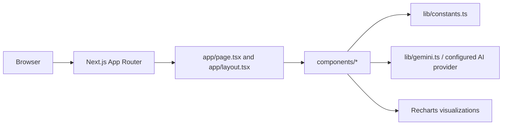

# Election Assistant

A Next.js 16 and React 18 educational election assistant. It presents election timelines, multilingual content, quizzes, charts, theme controls, and an optional voice/AI assistant in a responsive client application.

## Architecture



The repository is primarily a client-rendered experience. UI components own presentation and interaction; `lib/constants.ts` provides domain content and `lib/gemini.ts` isolates AI calls.

## Setup

```bash
npm ci
cp .env.example .env.local
npm run dev
# production
npm run build && npm start
```

Keep provider keys in `.env.local` or the deployment secret store. The development server normally runs on port `3000`.

## User workflow

Users explore the landing page, navigate the timeline, switch language/theme, answer quizzes, inspect chart data, and optionally use voice chat. AI requests are sent through the isolated Gemini helper and should be treated as untrusted external input/output.

## Deployment

Deploy as a Node.js Next.js service on Vercel or another platform that supports Next.js 16. Configure environment variables, build with `npm run build`, and start with `npm start`.

## Testing and limitations

No dedicated test runner is configured. Run the production build and manually test keyboard navigation, mobile layouts, language switching, charts, quiz state, and AI-provider failure states. Election information is educational content; verify facts and accessibility before public use.

## Security and operations

- Keep credentials, database URLs, OAuth tokens, API keys, and signing secrets in environment variables; never commit them.
- Validate and constrain uploaded files and user input at the server boundary, and enable HTTPS in production.
- Review dependency updates and rotate any credential that has appeared in repository history.

## Testing

The repository currently has no comprehensive automated test suite unless noted above. Before production changes, add tests for authentication/authorization, validation failures, persistence errors, and the primary user workflow.

## Limitations and roadmap

This is an actively evolving project. Production hardening, observability, rate limiting, backup/retention policy, and accessibility/performance validation should be completed before handling sensitive or high-volume workloads.

## License

See the repository license file and package metadata for the authoritative terms.
